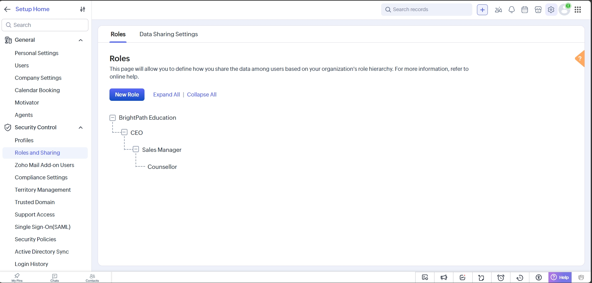
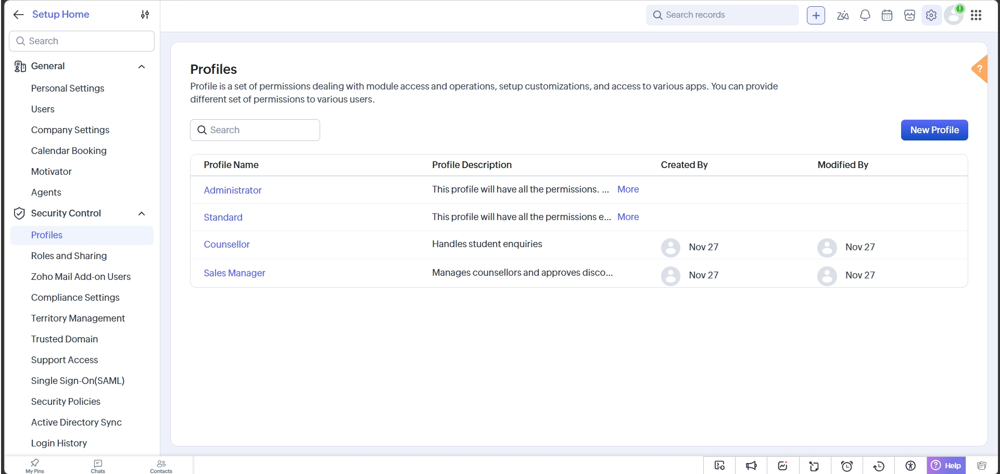
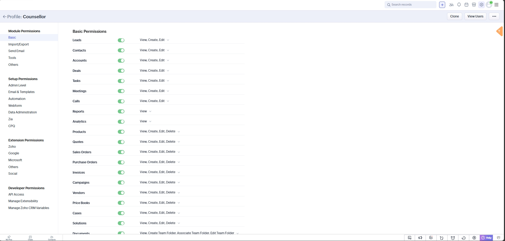
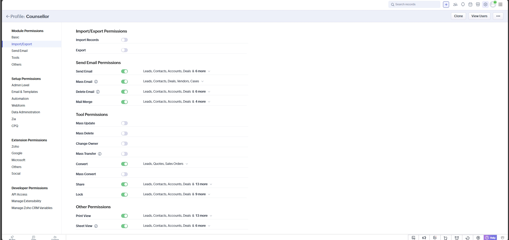
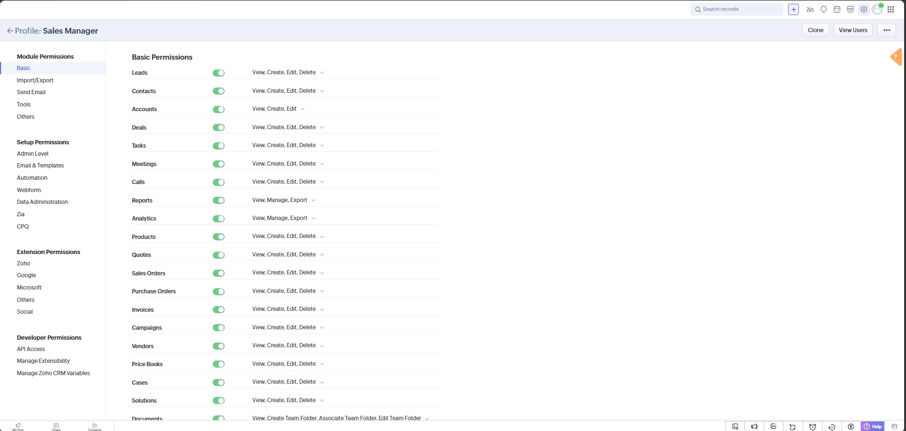
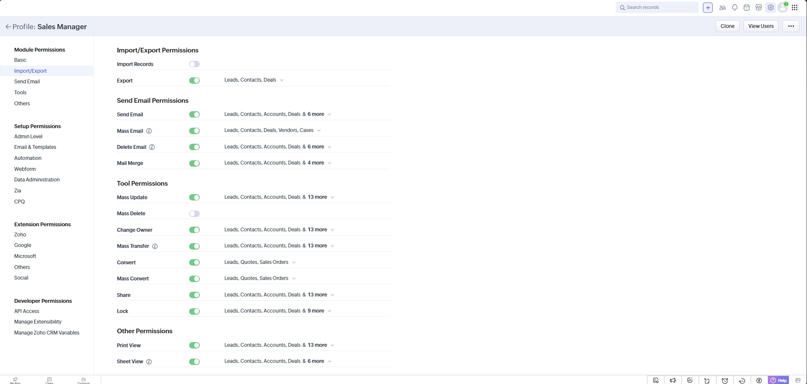

# Phase 2: Roles, Profiles and Users

## Role hierarchy
CEO > Sales Manager > Counsellor. Higher roles can see the records of the roles below them.

## Profiles
Both profiles were cloned from Standard and then restricted.

| Permission | Counsellor | Sales Manager |
|---|---|---|
| Delete leads and deals | No | Yes |
| Delete accounts | No | No |
| Export data | No | Leads, Contacts, Deals |
| Import data | No | No |
| Change owner / mass transfer | No | Yes |
| Reports | View | View, Manage, Export |
| Setup and admin permissions | No | No |

## Why these settings
Counsellors can work their own leads but cannot export, bulk-change or delete data. The Sales Manager can reassign leads and view reports. Only the Administrator changes setup.

## Users
(To be added once the users are created.)
